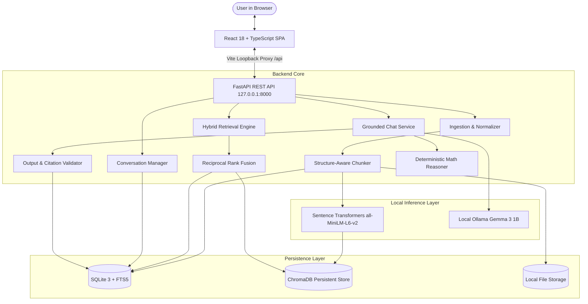

# GhostArchive

<div align="center">

**A local-first, evidence-grounded AI memory archive for your personal documents.**

[]()
[]()
[]()
[](./LICENSE)
[]()

</div>

---

GhostArchive helps you rediscover what your own collection of notes, letters, journals, and documents says — by meaning, not just keywords. You ask a question, and the app retrieves the original passages that support the answer, so you can verify every claim against the source text.

**The "ghost" is the trace left by words that survived their author or moment** — this is a tool for preservation, search, and evidence-grounded reflection, not simulation or impersonation.

---

## Architecture Overview

GhostArchive uses an authoritative SQLite database for source documents, chunk text, and conversations, paired with an auxiliary ChromaDB vector store and local Ollama model.



---

## Key Features

- **100% Local & Privacy-Preserving:** All imported files, extracted text, embeddings, and chat histories are stored strictly on your local machine (`backend/data/`). Nothing is sent to cloud vendors.
- **Evidence-Grounded Answers:** Answers are generated from retrieved passages only. The model is instructed to treat document passages as untrusted evidence, preventing prompt injection.
- **Strict Citation Validation:** Every citation is matched against real retrieved chunks in SQLite. Hallucinated chunk IDs are filtered out automatically.
- **Hybrid Retrieval (RRF):** Combines dense vector search (`all-MiniLM-L6-v2`) with SQLite FTS5 BM25 lexical search using Porter stemming to handle both conceptual queries and exact identifiers.
- **Structure-Aware Chunking:** Normalizes invisible characters and math symbols while preserving Markdown headings, code blocks, and source character offsets.
- **Conversation Persistence:** Multi-turn conversational context with turn idempotency (`client_turn_id`), turn recovery, and scoped context isolation.
- **Deterministic Math & Code Reasoning:** Automatically extracts signal formulas and parameters (e.g. Nyquist rates, sampling frequencies) and calculates verified derivations to prevent arithmetic hallucinations.
- **Resilient Error Architecture:** Uniform `ErrorEnvelope` across all API errors, React `ErrorBoundary` protection, and background service health monitoring.

---

## What GhostArchive Is (and Is Not)

| GhostArchive Does | GhostArchive Does NOT |
| :--- | :--- |
| :white_check_mark: Ingest `.txt` and `.md` files entirely locally. | :x: Send documents, questions, or vectors to cloud services. |
| :white_check_mark: Provide transparent source citations and similarity percentages. | :x: Simulate, impersonate, or claim to contact deceased individuals. |
| :white_check_mark: Tell you honestly when evidence is missing (`insufficient_evidence: true`). | :x: Invent dates, facts, quotes, or relationships not in the text. |
| :white_check_mark: Persist multi-turn conversations with idempotency. | :x: Parse scanned image PDFs, audio, or proprietary binary formats without prior text conversion. |
| :white_check_mark: Run completely offline once model weights are downloaded. | :x: Act as a public multi-tenant server (single-user loopback only). |

---

## Quick Start (Installation Guide)

### Prerequisites

| Component | Required Version | Purpose |
| :--- | :--- | :--- |
| **Python** | 3.11+ (tested on 3.11, 3.12, 3.13) | Backend API & RAG pipeline |
| **Node.js** | 18 LTS or 20 LTS | Frontend build & dev server |
| **[Ollama](https://ollama.com/)** | Latest | Local language model runner |
| **Git** | Any modern version | Source control |

> **Hardware Note:** Runs comfortably on standard consumer hardware (e.g., 8–16 GB RAM, 4 GB GPU or CPU).

---

### Step-by-Step Setup

#### 1. Clone the Repository
```bash
git clone https://github.com/hashiraCoder/GostArchive
cd GhostArchive
```

#### 2. Backend Setup
```bash
cd backend

# Create virtual environment
python -m venv venv

# Activate virtual environment
# Windows:
.\venv\Scripts\Activate.ps1
# macOS / Linux:
source venv/bin/activate

# Install dependencies
pip install -r requirements.txt
pip install -r requirements-dev.txt
```

#### 3. Pull the Local Language Model
```bash
# Ensure Ollama daemon is running, then pull the default model:
ollama pull gemma3:1b
```
*(The local embedding model `all-MiniLM-L6-v2` (~90 MB) downloads automatically from Hugging Face on first startup).*

#### 4. Configure Environment
```bash
# Copy example environment configuration
cp ../.env.example ../.env
```
Default settings work out of the box for local development.

#### 5. Start the Backend Server
```bash
# From within backend/ with venv activated:
uvicorn app.main:app --host 127.0.0.1 --port 8000 --reload
```
API documentation is available at `http://127.0.0.1:8000/docs`.

#### 6. Start the Frontend Application
In a separate terminal:
```bash
cd frontend
npm install
npm run dev
```
Open **`http://localhost:5173`** in your browser.

---

## Running the Automated Test Suites

GhostArchive maintains 100% test pass rate across 230 automated regression tests.

```bash
# 1. Run all backend tests (Pytest)
cd backend
pytest -v

# 2. Run all frontend tests (Vitest)
cd frontend
npm test

# 3. Type check frontend code
npm run type-check

# 4. Verify code formatting and linting
ruff check backend
ruff format --check backend

# 5. Run the deterministic evaluation benchmark
cd backend
python app/evaluation/runner.py --questions ../data/evaluation/questions.json --corpus ../data/sample_archive
```

---

## Documentation Index

Comprehensive documentation is available in the [`docs/`](./docs) directory:

- **Getting Started:**
  - [Installation Guide](./docs/getting-started/installation.md)
  - [Configuration Reference](./docs/getting-started/configuration.md)
  - [Troubleshooting & FAQ](./docs/getting-started/troubleshooting.md)
- **Architecture:**
  - [System Overview](./docs/architecture/system-overview.md)
  - [Backend Architecture](./docs/architecture/backend-architecture.md)
  - [Frontend Architecture](./docs/architecture/frontend-architecture.md)
  - [Ingestion Pipeline](./docs/architecture/ingestion-pipeline.md)
  - [RAG Pipeline & Grounding](./docs/architecture/rag-pipeline.md)
  - [Retrieval & Hybrid Ranking](./docs/architecture/retrieval-and-ranking.md)
- **User Guides:**
  - [Document Ingestion Guide](./docs/guides/document-ingestion.md)
  - [Search & Retrieval Guide](./docs/guides/search-and-retrieval.md)
  - [Conversational Q&A Guide](./docs/guides/conversational-qa.md)
- **API Reference:**
  - [Complete REST API Contract](./docs/api/api-reference.md)
- **Quality & Security Audits:**
  - [Repository Inventory](./docs/audit/REPOSITORY_INVENTORY.md)
  - [Functionality Audit](./docs/audit/FUNCTIONALITY_AUDIT.md)
  - [Security & Privacy Audit](./docs/audit/SECURITY_AUDIT.md)
  - [Code Quality Audit](./docs/audit/CODE_QUALITY_AUDIT.md)
  - [Testing Results](./docs/testing/TEST_RESULTS.md)

---

## License & Attribution

- **GhostArchive Codebase:** [MIT License](./LICENSE)
- **Dependencies & Models:**
  - FastAPI, React, Vite, Tailwind CSS: MIT License
  - ChromaDB, Sentence Transformers: Apache 2.0
  - Gemma 3 (via Ollama): [Gemma Terms of Use](https://ai.google.dev/gemma/terms)
  - all-MiniLM-L6-v2: Apache 2.0
