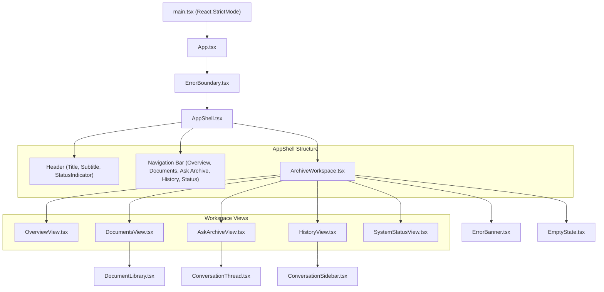

# Frontend Architecture & Component Hierarchy

The GhostArchive user interface is a responsive, single-page application built with React 18, TypeScript (strict mode), Vite, and Tailwind CSS.

---

## 1. Component Hierarchy & Flow

---

## 2. Views & Responsibilities

| View Component | Tab Key | Primary Responsibilities |
| :--- | :--- | :--- |
| **`OverviewView.tsx`** | `overview` | Dashboard overview: archive stats (doc count, chunks, storage), subsystem health status cards, quick archive summarization trigger. |
| **`DocumentsView.tsx`** | `documents` | Full document management: drag-and-drop file uploader, file size validation, search filter by name/title, status badges, chunk counts, single and bulk deletion. |
| **`AskArchiveView.tsx`** | `ask` | Grounded chat interface: document scoping dropdown, multi-turn message thread, evidence citations drawer with similarity match badges, limitations display, retry controls. |
| **`HistoryView.tsx`** | `conversations` | Conversation thread manager: list of active sessions, session creation, inline session renaming, session deletion with confirmation. |
| **`SystemStatusView.tsx`** | `status` | Deep diagnostic view: daemon reachability, model existence check, active inference probe trigger (`?check_inference=true`), latency display. |

---

## 3. Resilience & Error Handling

### 3.1 React Error Boundary (`ErrorBoundary.tsx`)
Wraps the entire application tree. If any rendering lifecycle or component unhandled exception occurs, `ErrorBoundary` catches the error and displays a recovery banner with a "Reload Application" button, preventing a blank white screen.

### 3.2 Typed API Client (`api/client.ts`)
- All network communication flows through `apiFetch`. Direct `fetch()` calls inside React components are forbidden.
- On HTTP 4xx or 5xx responses, `apiFetch` parses the standardized `ErrorEnvelope` JSON and throws a typed `ApiException`.
- If the backend is unreachable or returning non-JSON errors, it synthesizes an `ApiError` with code `SERVICE_UNREACHABLE` or `UNKNOWN_ERROR` and sets `retryable: true`.

### 3.3 Vite Dev Server Proxy (`vite.config.ts`)
The Vite proxy routes `/api/*` to `http://127.0.0.1:8000`. It includes an active `proxy.on("error")` handler that intercepts connection dropouts and returns a valid HTTP 503 JSON `ErrorEnvelope` rather than terminating the socket abruptly.

---

## 4. State Management Strategy

GhostArchive manages state locally in `ArchiveWorkspace.tsx` without heavy external state libraries:
- **Documents State:** Cached list of uploaded documents, upload progress flag, deleting ID.
- **Search & Scope State:** Selected document scope (`all` or specific UUID), search query, search results.
- **Chat & Conversation State:** Active conversation ID, active conversation thread messages, pending turn ID, asking flag, chat error.
- **System Readiness State:** Polled readiness object (`ReadyResponse`), last checked timestamp, loading flag.
- **Summary State:** Active archive or document summary object, summarizing flag.
