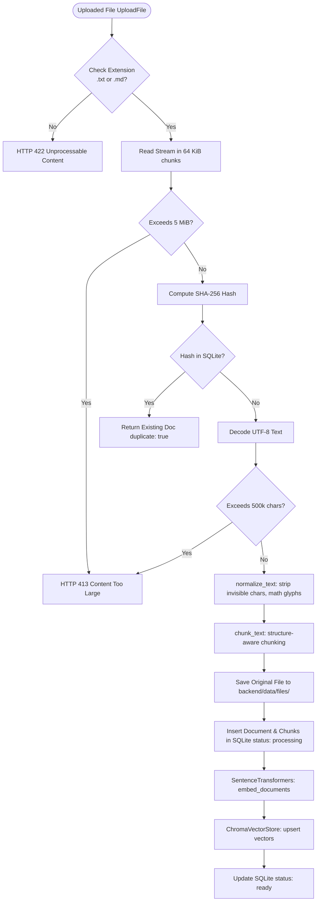

# Document Ingestion Pipeline

The document ingestion pipeline transforms raw user-uploaded files into normalized, structure-aware chunks, generates vector embeddings, and commits relational records in SQLite and ChromaDB.

---

## 1. Ingestion Pipeline Flowchart

---

## 2. Ingestion Stages

### Stage 1: Validation & Streaming Hash Calculation
1. **Extension Check:** Inspects original filename extension against `ALLOWED_EXTENSIONS = {".txt", ".md"}`.
2. **Byte Limit Inspection:** Reads data in 64 KiB chunks up to `settings.upload_max_bytes` (5 MiB).
3. **SHA-256 Deduplication:** Computes running hash. Queries SQLite `documents` for identical `content_hash`. If found, ingestion halts early and returns the existing document metadata with `duplicate: True`.

### Stage 2: Text Normalization (`ingestion/normalize.py`)
1. **Line Ending Standardization:** Converts `\r\n` and `\r` to `\n`.
2. **Invisible Character Stripping:** Removes zero-width spaces (`\u200b`, `\u200c`, `\u200d`, `\ufeff`, `\u2060`, `\u00ad`).
3. **Mathematical & Typographic Glyph Normalization:**
   - Converts inequality and math operators: `\u2265` $\rightarrow$ `>=`, `\u2264` $\rightarrow$ `<=`, `\u2260` $\rightarrow$ `!=`, `\u2212` $\rightarrow$ `-`, `\u00d7` $\rightarrow$ `*`, `\u00f7` $\rightarrow$ `/`.
   - Normalizes typographic smart quotes (`“`, `”`, `‘`, `’`) to standard ASCII quotes.
   - Normalizes spacing around inequality operators (`fs>=2fm` $\rightarrow$ `fs >= 2fm`).
4. **Whitespace Condensation:** Collapses multiple spaces on each line without flattening intentional line breaks.

### Stage 3: Structure-Aware Chunking (`ingestion/normalize.py`)
1. **Boundary Recognition:** Identifies atomic structural markers:
   - Markdown headings: `^#{1,6}\s+.+$`
   - Content metadata labels: `^(?:[A-Za-z0-9 _-]{2,30}):(?:\s+.*)?$` (e.g. `Aim:`, `Theory:`, `ENTRY:`)
   - Script starts: `^clc;\s*(?:clear;)?`
   - Structural alternatives: `^and alternative\b`
2. **Target Size & Overlap:** Merges lines into chunks up to `target_size` (900 characters) with `overlap` (120 characters).
3. **Paragraph Preservation:** Avoids splitting sentences or code lines mid-token. Slices very long unbroken paragraphs at whitespace boundaries.
4. **Offset Tracking:** Records exact `start_char` and `end_char` offsets relative to the normalized source document.

### Stage 4: Storage Commitment & Two-Phase State
1. File saved with server-generated UUID: `backend/data/files/{uuid}.{ext}`.
2. Insert document row with `status = 'processing'` in SQLite.
3. Insert chunks into `document_chunks` and `document_chunks_fts`.
4. Embed chunks with `all-MiniLM-L6-v2` and upsert vectors into ChromaDB.
5. Update document status to `'ready'`.
6. If an exception occurs at any point, the document is updated to `status = 'failed'` with an appropriate `error_code`.
