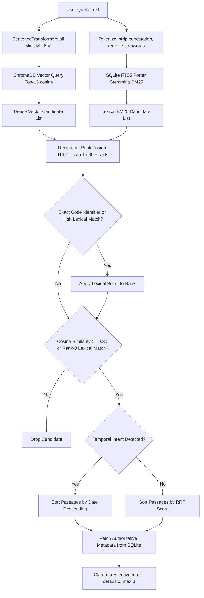

# Retrieval & Hybrid Ranking Architecture

GhostArchive employs a multi-stage hybrid retrieval strategy combining dense vector similarity with lexical BM25 ranking via Reciprocal Rank Fusion (RRF), enhanced by calibrated relevance thresholding and temporal ordering.

---

## 1. Hybrid Search Architecture

---

## 2. Multi-Stage Pipeline Breakdown

### 2.1 Dense Semantic Retrieval
- **Embedding Provider:** `SentenceTransformerProvider` (`retrieval/embeddings.py`).
- **Model:** `sentence-transformers/all-MiniLM-L6-v2` (384 dimensions, normalized).
- **Metric Space:** Cosine distance ($sim = 1.0 - distance$).
- **Candidate Pool:** Queries top 15 vector candidates from ChromaDB to provide a rich pool for fusion.

### 2.2 Lexical Retrieval with SQLite FTS5 & Porter Stemming
- **Virtual Table:** `document_chunks_fts` using `tokenize = 'porter unicode61'`.
- **Morphological Matching:** Porter stemming ensures that different word forms match (e.g., query "pollination" matches passages with "pollinates", "pollinated", or "pollinating").
- **BM25 Ranking:** SQLite calculates BM25 ranking scores across matched chunk contents.

### 2.3 Reciprocal Rank Fusion (RRF)
RRF combines ranked lists without requiring arbitrary score normalization:
$$RRF(d) = \sum_{m \in M} \frac{1}{60 + r_m(d)}$$
Where $r_m(d)$ is the zero-based rank of chunk $d$ in system $m$ (dense or lexical). Chunks appearing near the top of both lists receive the highest composite scores.

### 2.4 Exact Code Token Boosting
Dense vector embeddings often struggle with short code identifiers (e.g. `clc`, `stem`, `interp1`) because general-domain models treat them as rare tokens. If an exact lexical match occurs for code tokens, GhostArchive elevates the candidate to ensure technical scripts are retrieved accurately.

### 2.5 Calibrated Relevance Threshold Filtering
- **Threshold:** `settings.retrieval_min_similarity = 0.30`.
- Candidates with cosine similarity $< 0.30$ are filtered out unless rescued by a rank-0 exact lexical match.
- This threshold prevents irrelevant noise passages from polluting prompt context for out-of-domain questions.

### 2.6 Temporal Intent Ordering
Queries containing temporal markers ("latest", "recent", "newest", "timeline", "chronological") are detected by regex patterns. If detected, retrieved evidence is ordered by document/passage source date rather than raw similarity, ensuring that the language model sees the newest agreed decisions first.
