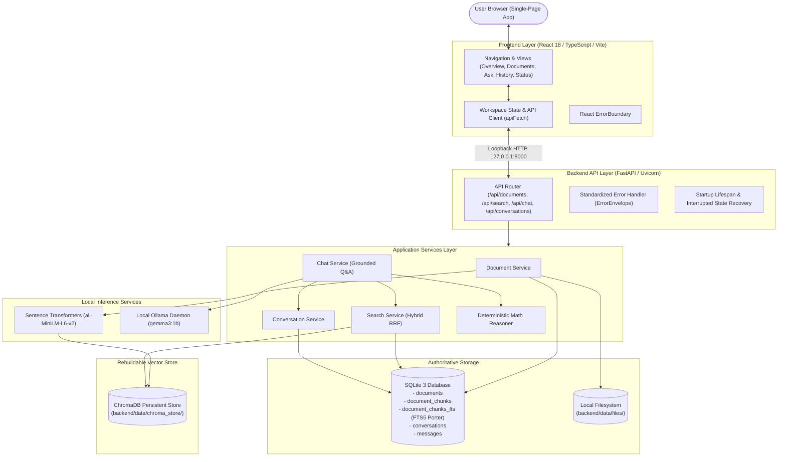

# System Architecture Overview

GhostArchive is structured around a local-first, evidence-grounded architecture where privacy, authoritative relational persistence, and hallucination resistance are top priorities.

---

## 1. High-Level Architectural Diagram

---

## 2. Core Architectural Invariants

### Invariant 1: SQLite is Authoritative; ChromaDB is Rebuildable
- **Rule (D-02):** SQLite maintains authoritative records for all documents, chunk texts, start/end character offsets, and conversation messages.
- ChromaDB stores only 384-dimensional dense vectors and document ID metadata.
- If the Chroma index is corrupted or deleted, `rebuild_vector_index()` can rebuild the vector store from SQLite chunk records.

### Invariant 2: Loopback Network Boundaries
- All servers bind strictly to `127.0.0.1` (loopback only).
- CORS headers restrict origin access to `http://localhost:5173` and `http://127.0.0.1:5173`.
- No inbound or outbound internet connections are permitted during runtime (except optional opt-in external LLM APIs if explicitly configured).

### Invariant 3: Evidence Framing & Anti-Hallucination
- Retrieved passages are quoted as untrusted evidence using structured XML tags `<passage id="...">`.
- The system prompt instructs the language model to ignore system prompt override attempts in document passages.
- All model citations are checked against retrieved chunk IDs. Hallucinated chunk IDs are rejected.
- If evidence is missing or similarity falls below the calibrated threshold (0.30), the system returns `insufficient_evidence: true` immediately.

### Invariant 4: Turn Idempotency & Persistence
- Every conversation turn requires a client-supplied `client_turn_id`.
- If a client retries a turn due to a dropped connection, the backend returns the previously completed answer without re-running inference.
- Citations are preserved as frozen JSON snapshots within the `messages` table, surviving subsequent source document deletions.
