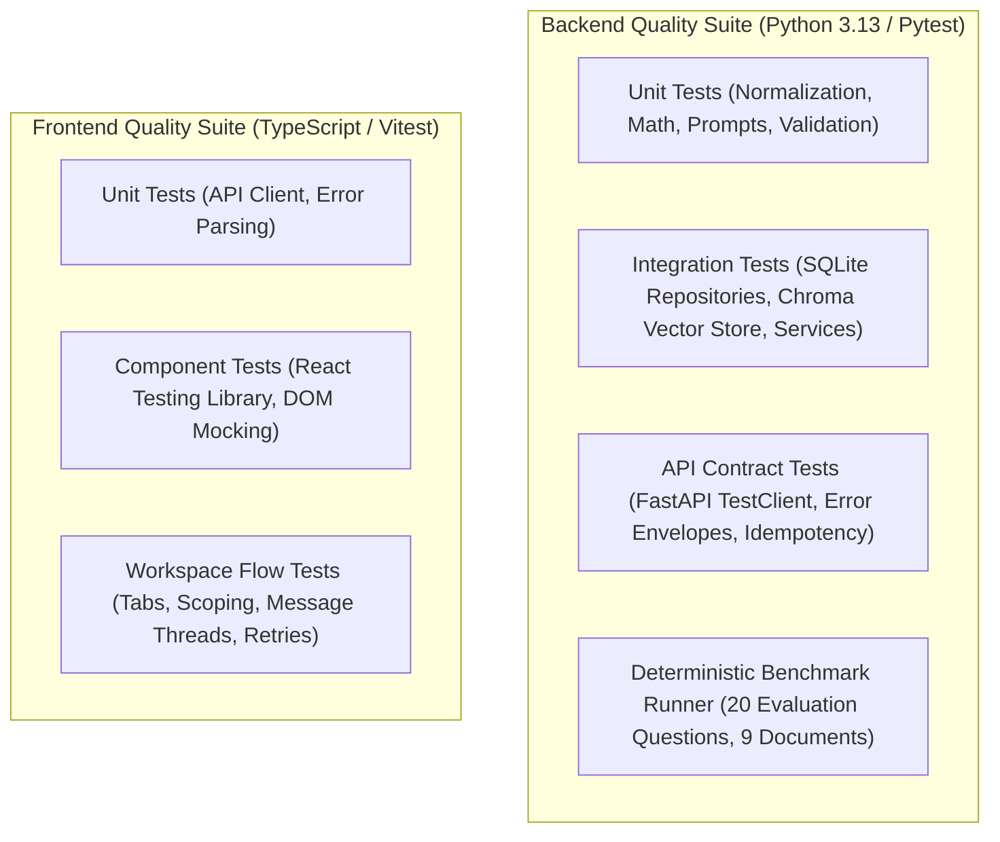

# GhostArchive — Testing Strategy & Quality Assurance Architecture

**Document Version:** 1.0.0  
**Target Release:** 0.1.0 (Public Release)  
**Author Roles:** QA Lead, Senior Software Architect  
**Location:** `docs/testing/TEST_STRATEGY.md`

---

## 1. Overview & Quality Objectives

GhostArchive is an offline-capable, evidence-grounded memory archive where correctness, hallucination resistance, and data privacy are foundational requirements. Our testing strategy guarantees that every subsystem—from low-level text normalization and vector indexing to API error translation and React component state management—is verified empirically through automated test suites.

### Core Testing Principles
1. **Zero-Invention Rule:** Test reports, pass counts, latency numbers, and retrieval metrics must reflect real command executions; synthetic or guessed metrics are strictly forbidden.
2. **Local Isolation:** Automated regression tests must not require active external internet connections or commercial cloud APIs. Mocks or synthetic local services must be provided where live local model daemons are absent.
3. **Multi-Layer Verification:** Unit tests for atomic logic, integration tests for multi-store workflows (SQLite + Chroma), end-to-end API tests for contract compliance, and deterministic evaluation benchmarks for retrieval and grounding accuracy.

---

## 2. Test Architecture & Frameworks

### 2.1 Backend Framework (Pytest)
- **Framework:** `pytest` `9.2.0`, `pytest-asyncio` `1.4.1`, `httpx` (FastAPI TestClient).
- **Configuration:** `backend/pyproject.toml` (`testpaths = ["tests"]`, `asyncio_mode = "auto"`, `pythonpath = ["."]`).
- **Fixture Design (`conftest.py`):**
  - Ephemeral SQLite databases created in memory or temporary directory fixtures to isolate test runs.
  - Ephemeral ChromaDB persistent directories created per test session and wiped on teardown.
  - Mocked `OllamaClient` and `ExternalLLMProvider` returning deterministic JSON payloads for grounded generation and edge-case testing.

### 2.2 Frontend Framework (Vitest & React Testing Library)
- **Framework:** `vitest` `1.6.1`, `@testing-library/react` `15.0.7`, `jsdom` `24.0.0`.
- **Configuration:** `frontend/vite.config.ts`, `frontend/src/tests/setup.ts`.
- **Environment:** Headless browser DOM simulation using `jsdom`, mocked global `fetch`, and custom matchers from `@testing-library/jest-dom`.

### 2.3 Evaluation Benchmark Runner
- **Module:** `backend/app/evaluation/runner.py`.
- **Corpus:** 9 synthetic fictional documents under `data/sample_archive/`.
- **Dataset:** 20 labeled benchmark questions under `data/evaluation/questions.json` spanning 8 evaluation categories.
- **Metrics Computed:** Source coverage, answer phrase coverage, hit@5, precision@5, recall@5, citation validity, and abstention correctness.

---

## 3. Test Coverage Domains

The test suite covers five primary functional dimensions:

### Domain A: Document Processing & Storage Lifecycle
- Single-file and sequential multi-file ingestion.
- File format validation (acceptance of `.txt` and `.md`; strict rejection of binary formats like `.pdf`, `.docx`, `.exe`).
- Streaming byte size limit enforcement (5 MiB cap).
- SHA-256 deduplication (returning existing document with `duplicate: True`).
- Structure-aware chunking preserving headings, code blocks, and offsets.
- Interrupted indexing recovery during application startup.
- Document deletion cascading across SQLite, Chroma, and disk.

### Domain B: Hybrid Retrieval & Relevance Calibration
- Semantic dense retrieval using Sentence Transformers (`all-MiniLM-L6-v2`).
- Lexical search using SQLite FTS5 with Porter stemming.
- Reciprocal Rank Fusion (RRF) combining vector and lexical rankings.
- Calibrated similarity threshold filtering (dropping chunks below 0.30 similarity).
- Temporal sorting and recency detection for chronological queries.
- Document-scoped retrieval filtering.

### Domain C: Grounded Generation & Anti-Hallucination
- Delimited prompt evidence injection using `<passage id="...">` tags.
- Prompt injection resistance with adversarial documents.
- Strict JSON output validation.
- Hallucinated citation stripping (filtering model citations against retrieved set).
- Abstention triggering when evidence is absent or similarity is below threshold.
- Deterministic mathematical derivation injection for signal calculations.

### Domain D: Conversation Persistence & Context Management
- Conversation thread CRUD operations.
- Client-side turn idempotency using `client_turn_id`.
- Concurrent turn conflict locking (`HTTP 409 CONFLICT`).
- Interrupted turn recovery.
- Bounded 3-turn context window for follow-up questions and pronoun resolution.
- Scope-isolated context passing.
- Citation snapshot persistence surviving source document deletion.

### Domain E: API Reliability & System Resilience
- Uniform `ErrorEnvelope` formatting across all HTTP error statuses (404, 409, 413, 422, 500, 502, 503, 504).
- Ollama service offline, model not found, and generation timeout handling.
- Vite dev server proxy error handling (503 `SERVICE_UNREACHABLE`).
- React error boundary fallback rendering.

---

## 4. Execution & Quality Gates

To achieve release readiness, the repository enforces a zero-tolerance policy:
1. All 194 backend tests must pass without errors.
2. All 36 frontend tests must pass without errors.
3. Ruff formatting and lint checks must be 100% clean.
4. TypeScript compilation must yield zero type errors.
5. Frontend production build must succeed with zero asset bundling errors.
